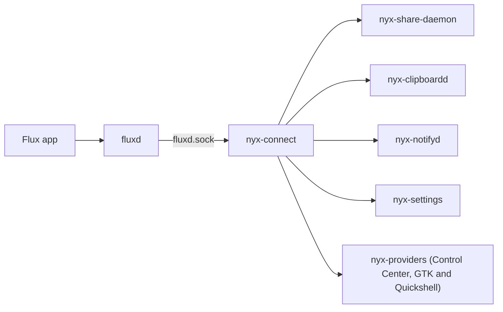

# Nyx Connect: Flux on Nyx (Handoff 06)

Nyx Connect is how Nyx shows and uses [Flux](https://github.com/bjarneo/flux), the
phone link that Omarchy ships as `omarchy-flux`. It is not a protocol and not a daemon:
upstream `fluxd` does discovery, pairing, transport and the phone features, and a small
Rust library, `nyx-connect` in nyx-core, turns `fluxd`'s state into Nyx's device model
for the apps that use it.

Audited against Flux **v0.19.1** (tag `c0c831b`, 2026-10-29), the release Omarchy
installs and the Flux for Android app Ken's phone runs. The local checkout was still at
v0.7.1; everything below comes from the v0.19.1 source (`git worktree` of the tag) and a
read-only `state` call to the running `fluxd`.

## What Flux is

- Go, by Bjarne Øverli and contributors, MIT. `fluxd` (user daemon), `flux-cli`,
  `flux-gui` (Qt), an omarchy-shell plugin, `flux-approve` (PAM helper for sudo by
  fingerprint), and the apps: Flux for Android (10+), iOS (17+) and macOS (14+).
- Protocol: "Flux protocol version 8", JSON packets over TLS with self-signed ECDSA
  certificates that each side pins at pairing; discovery by UDP broadcast and mDNS
  (`_flux._udp`); port 12100 (TCP and UDP). It started as a KDE Connect
  reimplementation and dropped KDE Connect compatibility in v0.7.0: **the official apps
  are Flux's own**, and KDE Connect or GSConnect can't connect.
- No D-Bus service. Its only interface is JSON lines on
  `$FLUX_SOCKET` or `$XDG_RUNTIME_DIR/flux/fluxd.sock` (0600 in a 0700 folder; the
  client checks `SO_PEERCRED`). `state` returns a snapshot; `subscribe` streams `state`
  events (only on change, coalesced, the newest replaces an unread one) and `toast`s.
  Errors are `{code, message}` with stable codes. Documented in `docs/ipc.md`.
- Trust lives in `~/.local/share/flux/devices.json`; settings, device policies and
  notification rules in `~/.config/flux/config.toml`.

## Capability matrix

| Feature | Flux (0.19.1) | Interface | Nyx today | Overlap and decision |
| --- | --- | --- | --- | --- |
| Discovery | UDP + mDNS, extra addresses (Tailscale names), Wake-on-LAN | `discover`, `addresses.*`, `devices[]` | none | Flux owns it. Nyx lists what `fluxd` reports. |
| Pairing | Request, accept/reject with a 16-hex-digit verification key, 30 s timeout, `confirm` step when the phone accepted first | `pair.request/accept/reject/unpair`, `pairState`, `pairKey`, `fingerprint` | none | Flux owns it. Settings drives the same flow, always sends the compared key. |
| Device state | `online`, `paired`, `pairState` (`none`, `requested`, `confirm`, `incoming`, `paired`), `lastSeen`, `battery`, `plugins`, `app`, `appVersion`, `oldApp` | `state` / `subscribe` | none | Normalized by `nyx-connect`. No "connecting" state exists; none is invented. |
| Per-device access | `device.settings.set` for `clipboard`, `notifications`, `shareHome`, `remoteInput`, `remoteDesktop`, `herdr*` (true, false, or null to inherit) | `device.settings`, `settings.deviceRules` | none | Flux's policy is the authority; Settings edits it. |
| File transfer out | Outbox (survives offline devices), progress, retry, cancel | `share.files`, `transfer.*`, `transfers[]` | nyx-share `flux:` provider (send only, polls `state`) | Kept in Share; moved onto `nyx-connect` and `subscribe`. |
| File transfer in | Saved to `downloadDir`, `.part` then rename, basename only, unique names | `transfers[]` with `dir: "in"` | Share receives only from LocalSend | Share shows incoming Flux transfers as Receive jobs (Flux already wrote the file). |
| Text and links | `share.text`, `share.url` (http/https only) | same | Share's `flux:` text/link | Kept. |
| Clipboard sync | Its own `wl-paste --watch`, its own history (50, 500 max), snippets; skips `CLIPBOARD_STATE=sensitive` | `autoClipboard`, `clipboard.send`, `clipboard.search`, `clipboard[]` | Nyx Clipboard: history, excluded apps, secret detection, private mode, codes | **Overlap.** With Nyx sync on, `autoClipboard` is off and Nyx Clipboard sends (after its policies) and receives (from `clipboard[]` entries with `dir: "in"`). |
| Phone notifications | Shown through `org.freedesktop.Notifications` as `App · Device`, with action keys `notif-action:<device>:…`; rules (mute, silent, quiet hours) | `notifications` setting, `notification.rule.*`, `notification.*` | Nyx notifyd stores whatever arrives | No second store. notifyd recognizes `fluxd` and records the source device; Flux's replace IDs keep updates in one row. |
| Notifications to the phone | Only on request | `notify.send` | none | Nothing is forwarded automatically. |
| Battery | Phone battery, low-battery notice | `devices[].battery` | Control Center battery is the laptop's | Shown on the device tile. |
| Find my phone | Ring | `ring` | none | Control Center and Settings action, when `findmyphone` is in `plugins`. |
| SMS | Threads, send, outbox | `sms.*` | Share `flux-sms:` | Kept in Share; no other Nyx UI. |
| Run commands | Phone runs desktop commands | `commands.*` | none | Not exposed: Flux's own window manages them. |
| Webcam, mic, screen, remote desktop/input, herdr, approval | Yes | various | none | Out of scope (Flux's window); remote access switches appear read-only in diagnostics. |
| Browse PC (SFTP of the home folder) | **On by default** (`shareHome`) | `shareHome`, `device.settings` | none | Settings shows and turns it off; NyxOS ships it off. |

## Security notes

- `shareHome` defaults to on upstream: a paired phone can browse the whole home folder.
  NyxOS's default `config.toml` turns it off; Settings shows it with a warning.
- Clipboard: with `autoClipboard` on, Flux sends every copy that isn't marked sensitive
  by the password-manager hint. Nyx's excluded apps and secret detection only apply when
  Nyx Clipboard does the sync.
- 0.19.1 opens and sends only http and https links with a host (`webURL`), so the
  v0.7.1 issue of a phone's link reaching `xdg-open` with any scheme is fixed. A link a
  paired phone shares still opens in the browser at once.
- `nyx-connect` never logs clipboard text, notification bodies, file names or keys.

## Process model

No Nyx Connect daemon. `fluxd` is the one device process; each Nyx service that needs it
links `nyx-connect` and opens its own socket connection (fluxd serves many clients):

- `nyx-connect` is blocking and runtime-free: a request client, a `Watch` thread that
  subscribes, reconnects with backoff and hands each snapshot to a callback, and the
  normalized model. When `fluxd` isn't there, every consumer reports "unavailable" and
  keeps working without it.
- `nyx-capability` gets a `connect` provider (`connect:flux`): not installed, inactive
  (installed, no socket), or available.
- What each device may do is fluxd's own per-device access (`device.settings`), so the
  phone and Flux's window agree with Settings. Nyx's only choice of its own is whether
  Nyx Clipboard does the syncing (`clipboard_sync` in `connect.toml`, in NyxOS's
  configuration layers; Nyx keeps fluxd's `autoClipboard` off meanwhile and gives the old
  value back after).
- Remembered devices: paired devices that are away are listed under Remembered Devices,
  where their access can still change. A device is recorded in `nyx-devices` as
  `linked:<flux id>` once it's configured here (paired, or access changed); one that's
  recorded but no longer paired in fluxd is shown so it can be forgotten.
- **Unpair** removes Flux's trust (`pair.unpair`); the phone must pair again, and its
  access choices stay for then. **Forget** clears its access choices, unpairs it if it's
  still paired (no stale trust left behind) and removes it from the remembered devices.

## Versions and patches

- NyxOS builds `fluxd` and `flux-cli` from a pinned upstream tag (`nyx-packages`
  `pkgs/flux.nix`); a new tag is pinned only after pairing, clipboard, notifications
  and a transfer are checked with the current Flux for Android.
- No patches today. Anything Nyx needs from Flux goes upstream as a small,
  compatible change.

| Flux | Flux for Android tested | Notes |
| --- | --- | --- |
| 0.19.1 | 0.19.1 | Port 12100, outbox, per-device policies, clipboard history in `fluxd` |

## When fluxd is missing or stops

- Share lists no Flux destinations; LocalSend and the rest work.
- Clipboard keeps its history and stops syncing; nothing waits on the socket.
- Notifications keep arriving from everything else.
- Settings' Devices page and the Control Center tile say Flux isn't running and offer
  to start `fluxd.service`.
- When `fluxd` comes back, `nyx-connect` resubscribes and the state is rebuilt from the
  first snapshot (no duplicate events: consumers compare IDs).

## What uses it

| Where | What it does with Flux |
| --- | --- |
| nyx-core `nyx-connect` | `Client`, `Watch`, the normalized model, `connect.toml`, remembered linked devices and Forget |
| nyx-core `nyx-capability` | `daemon:flux` (`providers::Connect`): available, inactive (installed, not running), not installed |
| nyx-core `nyx-devices` | `Category::Linked`: `linked:<flux id>` once a device is configured |
| nyx-share | Sends through `nyx-connect` and follows transfers with `subscribe`; files a device sends become Receive jobs (`flux-in:<transfer>`), caught up on when the service starts (`$XDG_STATE_HOME/nyx-share/flux-received`), never notified twice (fluxd already says) |
| nyx-clipboard | With `clipboard_sync` on: what the watcher keeps (after private mode, the password-manager hint, excluded apps and secrets) goes to each connected device with clipboard access; a device's copy comes back through `clip::set_remote` with `application/x-nyx-clipboard-remote`, so it's stored with its device (`entries.origin = flux:<id>`, `app` = its name) and never sent back; codes (Otp1) carry the password-manager hint and never sync |
| nyx-notification-center | In Nyx mode, `nyx-notifyd` knows fluxd by its executable and reads the device from fluxd's button keys (`notif-action:<device>:…`), else by name; it keeps `device` and a `source_key`, so a notification fluxd sends again after a restart updates its row |
| nyx-settings | Connected Devices (Connections; Network on NyxOS): clipboard sync, notifications, Browse PC, pairing with the compared key, each device's access, Unpair and Forget, Remembered Devices, diagnostics |
| nyx-control-center | The Devices tile and view (GTK and Quickshell, `nyx-providers::devices`): connected devices, battery, Ring, Send clipboard, Start Flux; on NyxOS's default layout |
| nyx-packages, nyxos | `pkgs/flux.nix` (v0.19.1), `nyx.connect.enable` (unit, port 12100, Avahi), on by default with `share_home = false` and `check_updates = false` for new users |

In Omarchy mode, Omarchy's shell receives notifications, so the device isn't recorded
there; the row still names it (`App · Device`).

## Next

- **Shared actions** (Glimpse, Assistant): `connect.ring`, `connect.send_clipboard`
  (external, asks first) and `connect.list` (read-only) through AI Core's registry. The
  owner has to stay on the bus: the Control Center backend or a small `Control` server in
  `nyx-clipboardd`, both always running. Not built yet.
- **Upstream**: a `x-flux-device` hint on fluxd's notifications would make the device
  exact for ones without buttons, and a per-device `share` policy would let Settings keep
  a device from sending files.

## Not done, and why

- No Nyx mobile app, protocol change or fork.
- Flux's own window (`flux-gui`, the omarchy-shell plugin) stays for what Nyx doesn't
  show: commands, SMS threads, streams, herdr, approval.
- Outgoing desktop notifications stay manual (`notify.send`).
